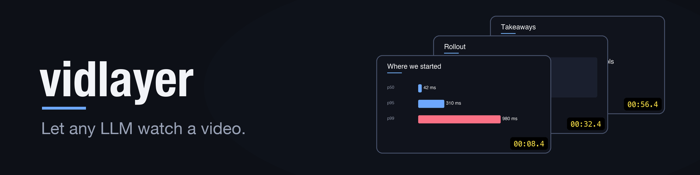
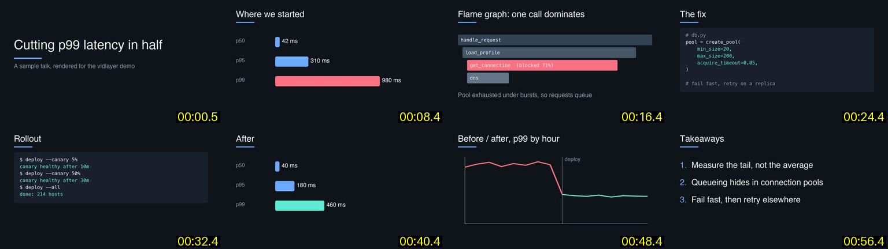
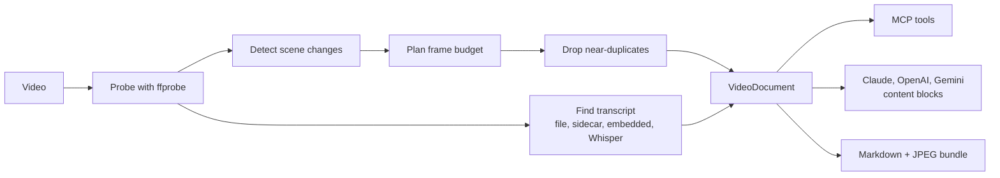

<p align="center">
  
</p>

vidlayer converts a video into timestamped keyframes and a transcript, so models that only accept text and images can work with it. You can use the output directly with Claude, OpenAI-compatible APIs, or Gemini, or run vidlayer as an MCP server and let the model request frames itself.

## Example

This is the storyboard `open_video` returns for a one-minute sample talk:

<p align="center">
  
</p>

The model also gets the transcript, lined up with the frames:

```text
<video source="talk.mp4" duration="01:04.0" resolution="1920x1080" fps="10.0">
[00:00.5] keyframe (start):        [image]
Transcript:
[00:01.0] Today I'll show how we cut our p99 latency in half.
[00:08.4] keyframe (scene-change): [image]
Transcript:
[00:09.0] Here's where we started. The median was fine, but the tail was nearly a second.
[00:16.4] keyframe (scene-change): [image]
Transcript:
[00:17.0] The flame graph points at one call: we were blocked waiting on a connection.
...
```

## Install

You need [uv](https://docs.astral.sh/uv/getting-started/installation/) on your PATH and [ffmpeg](https://ffmpeg.org/download.html) installed (`brew install ffmpeg` on a Mac). In Claude Code, run:

```text
/plugin install vidlayer --marketplace riceelijah/vid-layer
```

On Claude Code older than 2.1.275, add the marketplace first:

```text
/plugin marketplace add riceelijah/vid-layer
/plugin install vidlayer@vid-layer
```

The plugin includes the MCP server and a `watch-video` skill. Once it's installed, ask about a video by its path:

```text
What's the UI bug in ~/Videos/demo.mp4 around the 3-minute mark?
```

## MCP tools

| Tool | Returns |
|---|---|
| `open_video(path)` | Metadata, keyframe list, transcript, and a storyboard image |
| `get_frames(id, start, end, count)` | Evenly spaced frames from a time range and the speech in it, or a single tiled image with `as_storyboard` |
| `get_frame(id, t, max_dim)` | One high-resolution frame, useful for small text, code, and charts |
| `get_transcript(id, start, end)` | The transcript for a time range |

A model usually starts with `open_video`, then requests frames for the parts it needs.

## How it works



ffmpeg's scene detector runs on a downscaled copy of the video to find cuts and slide changes. vidlayer keeps the strongest ones that fit the frame budget and adds evenly spaced frames to fill long gaps. Interval frames and weak cuts are dropped if they look almost the same as the previous frame.

For the transcript, it uses the first of these it finds: a file passed with `--transcript`, a sidecar like `video.srt` or `video.en.vtt`, an embedded subtitle track, or local Whisper if it's installed.

> [!NOTE]
> Small edits, like one new bullet on a slide, and some slow fades aren't detected as scene changes. These only show up in interval frames, which can be well after the change on a long video with a small frame budget. To catch them, raise `--max-frames` or sample the range with `get_frames`.

## Other ways to use it

<details>
<summary>Other MCP clients (Claude Desktop, Cursor)</summary>

```bash
pip install "vidlayer[mcp] @ git+https://github.com/riceelijah/vid-layer"
```

For Claude Desktop, add this to `claude_desktop_config.json`:

```json
{ "mcpServers": { "vidlayer": { "command": "vidlayer", "args": ["mcp"] } } }
```

</details>

<details>
<summary>File bundle, without MCP</summary>

```bash
vidlayer build demo.mp4 -o demo.vidlayer
```

This writes `video.md` and a folder of JPEGs. Point any tool that can read local files at `demo.vidlayer/video.md`.

</details>

<details>
<summary>Python</summary>

```python
from vidlayer import VideoDocument, to_anthropic, to_openai, to_gemini

doc = VideoDocument.build("talk.mp4", max_frames=32)

# Claude
client.messages.create(model="claude-opus-5-5", max_tokens=16000, messages=[
    {"role": "user", "content": to_anthropic(doc) + [{"type": "text", "text": "Summarize the slides."}]}
])

# OpenAI-compatible APIs
{"role": "user", "content": to_openai(doc) + [{"type": "text", "text": "..."}]}

# Gemini (REST `parts`)
{"role": "user", "parts": to_gemini(doc) + [{"text": "..."}]}
```

</details>

<details>
<summary>Command line</summary>

```bash
vidlayer ask demo.mp4 "What command gets run at the end?"   # needs ANTHROPIC_API_KEY
vidlayer render demo.mp4 --format openai > content.json
vidlayer build "https://youtube.com/watch?v=..."            # needs vidlayer[url]
```

Options: `--max-frames`, `--max-dim`, `--scene-threshold`, `--transcript subs.vtt`, `--no-asr`.

</details>

<details>
<summary>Optional dependencies</summary>

```bash
pip install -e ".[mcp]"   # MCP server
pip install -e ".[all]"   # also Whisper, yt-dlp, and the Anthropic SDK
```

</details>

## Token cost

Claude charges roughly `width × height / 750` tokens per image.

| Item | Size | Tokens |
|---|---|---|
| One 16:9 keyframe | 768×432 | about 440 |
| 32 keyframes (the default) | | about 14k, plus the transcript |
| MCP storyboard with 16 thumbnails | 1536×864 | about 1.8k |

`vidlayer build` prints an estimate for each video.

## Roadmap

- [ ] OCR on frames, for searching on-screen text, text-only models, and catching small slide edits
- [ ] Speaker diarization
- [ ] Audio events other than speech (music, laughter, alarms)
- [ ] Per-scene captions from a cheap vision model
- [ ] More frames where the speaker refers to the screen
- [ ] On-disk cache for the MCP server
- [ ] `get_clip` tool for models that accept video

## Development

```bash
pip install -e ".[dev,mcp]"
pytest
```

The tests generate their own video with ffmpeg, so there are no fixture files.

## License

[MIT](LICENSE)
