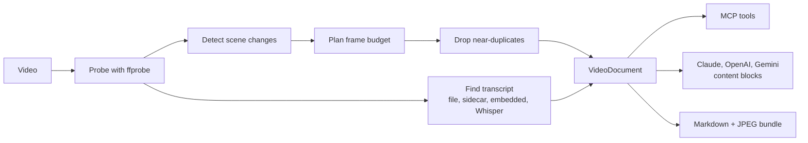

<p align="center">
  
</p>

<p align="center">
  <a href="LICENSE"></a>
  
  
  
</p>

<p align="center">
  <a href="#quick-start">Quick start</a> ·
  <a href="#how-it-works">How it works</a> ·
  <a href="#other-ways-to-use-it">Other ways to use it</a> ·
  <a href="#cost">Cost</a> ·
  <a href="#roadmap">Roadmap</a>
</p>

Most models can't take video, so the usual workaround is pasting a transcript. That throws away everything you *see*: slides, code on screen, diagrams, demos, what changed when.

**vidlayer** turns a video into something any vision-capable LLM can read: timestamped keyframes interleaved with the transcript on one timeline. It also runs as an **MCP server**, so the model can *watch* the video itself: skim a storyboard, then zoom in on the moments that matter.

## See it

This is the real storyboard `open_video` returns for a one-minute sample talk. One image gives the model the whole video:

<p align="center">
  
</p>

The transcript comes with it, lined up against the same timestamps:

```text
<video source="talk.mp4" duration="01:04.0" resolution="1920x1080" fps="10.0">
[00:00.5] keyframe (start):    [image]
Transcript:
[00:01.0] Today I'll show how we cut our p99 latency in half.
[00:09.0] keyframe (interval): [image]
Transcript:
[00:09.0] Here's where we started. The median was fine, but the tail was nearly a second.
[00:17.0] The flame graph points at one call: we were blocked waiting on a connection.
...
</video>
```

## Quick start

You'll need [`uv`](https://docs.astral.sh/uv/getting-started/installation/) on your PATH and [ffmpeg](https://ffmpeg.org/download.html) installed (`brew install ffmpeg`). Then, in Claude Code:

```text
/plugin install vidlayer --marketplace riceelijah/vid-layer
```

On a Claude Code version older than 2.1.275, add the marketplace first:

```text
/plugin marketplace add riceelijah/vid-layer
/plugin install vidlayer@vid-layer
```

That's it. The plugin bundles the MCP server, which `uvx` runs with no separate `pip install`, plus a `watch-video` skill that tells Claude when and how to use it. Then just ask:

> *What's the UI bug in ~/Videos/demo.mp4 around the 3-minute mark?*

### Tools

| Tool | What it gives the model |
|---|---|
| `open_video(path)` | Metadata, keyframe list, full transcript, and a **storyboard** tiling the keyframes with timestamps |
| `get_frames(id, start, end, count)` | `count` frames evenly spaced over a range, plus the speech in it (or tiled into one image with `as_storyboard`) |
| `get_frame(id, t, max_dim)` | One high-res frame, for reading small text, code, and charts |
| `get_transcript(id, start, end)` | Exact words for a range |

The model starts from a cheap overview and spends image tokens only where it needs detail, instead of you guessing a frame rate up front.

## How it works



1. **Probe** the file with `ffprobe`.
2. **Find scene changes** with ffmpeg's scene detector, run on a downscaled stream so it's fast.
3. **Plan a frame budget**: take the strongest cuts, then fill long stretches with interval samples. Interval frames that nearly match the previous one are dropped, so a static screen doesn't burn tokens.
4. **Get a transcript** from the cheapest source available: a `--transcript` file, a sidecar `video.srt` or `video.en.vtt`, an embedded subtitle track, or local Whisper.
5. **Interleave** frames and speech into one `VideoDocument`, then render it for whichever model you're using.

> [!NOTE]
> The default scene threshold catches hard cuts, not gentle changes. Slides on a shared background score well below it, so they're picked up by interval sampling, which can land a few seconds after the change. In the CLI, `--scene-threshold 0.03` catches those changes at the exact moment.

## Other ways to use it

<details>
<summary><b>Any other MCP client</b> (Claude Desktop, Cursor, …)</summary>

```bash
pip install "vidlayer[mcp] @ git+https://github.com/riceelijah/vid-layer"
```

Claude Desktop (`claude_desktop_config.json`):

```json
{ "mcpServers": { "vidlayer": { "command": "vidlayer", "args": ["mcp"] } } }
```

</details>

<details>
<summary><b>Without MCP</b> (a file bundle anything can read)</summary>

```bash
vidlayer build demo.mp4 -o demo.vidlayer
```

Then: *"Read demo.vidlayer/video.md and the frames it references."* The bundle is plain Markdown and JPEGs.

</details>

<details>
<summary><b>In your own code</b> (any provider)</summary>

```python
from vidlayer import VideoDocument, to_anthropic, to_openai, to_gemini

doc = VideoDocument.build("talk.mp4", max_frames=32)

# Claude
client.messages.create(model="claude-opus-5-5", max_tokens=16000, messages=[
    {"role": "user", "content": to_anthropic(doc) + [{"type": "text", "text": "Summarize the slides."}]}
])

# OpenAI-compatible (OpenAI, OpenRouter, vLLM, Ollama, LM Studio…)
{"role": "user", "content": to_openai(doc) + [{"type": "text", "text": "..."}]}

# Gemini (REST `parts`)
{"role": "user", "parts": to_gemini(doc) + [{"text": "..."}]}
```

`VideoDocument` doesn't depend on any provider, and each adapter is only a few lines.

</details>

<details>
<summary><b>Command line</b></summary>

```bash
vidlayer ask demo.mp4 "What command gets run at the end?"   # needs ANTHROPIC_API_KEY
vidlayer render demo.mp4 --format openai > content.json     # raw content blocks
vidlayer build "https://youtube.com/watch?v=..."            # needs vidlayer[url]
```

Useful options: `--max-frames` (budget), `--max-dim` (frame resolution), `--scene-threshold` (lower is more sensitive), `--transcript subs.vtt`, `--no-asr`.

</details>

<details>
<summary><b>Optional extras</b></summary>

```bash
pip install -e ".[mcp]"   # core + MCP server
pip install -e ".[all]"   # + Whisper speech-to-text, URL download (yt-dlp), Anthropic SDK
```

</details>

## Cost

Claude charges roughly `width × height / 750` tokens per image.

| What | Size | Tokens |
|---|---|---|
| One keyframe, 16:9 | 768×432 | about 440 |
| Default 32 keyframes | | about 14k, plus the transcript |
| MCP storyboard, 16 thumbnails | 1536×864 | about 1.8k |

`build` prints an estimate for each video.

## Roadmap

- [ ] Reliable slide-change detection without manual threshold tuning
- [ ] OCR pass on frames, so on-screen text can be searched and fed to text-only models
- [ ] Speaker diarization (who said what)
- [ ] Audio events beyond speech (music, laughter, alarms) via an audio tagger
- [ ] Per-scene captions from a cheap vision model, for text-only LLMs and very long videos
- [ ] Transcript-aware frame selection (sample more densely when the speaker says "look at this")
- [ ] Persistent on-disk cache for the MCP server
- [ ] Clip extraction tool (`get_clip` → short GIF/MP4 for models that accept video)

## Development

```bash
pip install -e ".[dev,mcp]"
pytest
```

Tests generate a synthetic video with ffmpeg, so they don't need any fixtures.

## License

[MIT](LICENSE)
